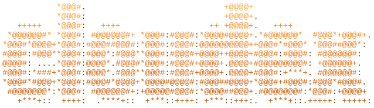

<h1 align="center"></h1>

Open-source agent computers that run in your own Cloudflare account. Each sandbox
is a Linux machine with a shell, Docker, SSH and coding agents. Stopping saves its
disk; resuming brings it back. You pay Cloudflare directly; there is no Cloudex
service in between. Site: [cloudex.build](https://cloudex.build).

**Status: v0.1, pre-alpha.** Expect rough edges and breaking changes.

## What you need

- A Cloudflare account on **Workers Paid** ($5/month). Containers need it.
- An OpenSSH client, and Node.js 20+ for `cloudex deploy` (it runs Cloudflare's wrangler).
- Optional: a domain in the same Cloudflare account, for preview links. Cloudex adds
  a proxied `*.<domain>` record and routes `*.<domain>/*` to its Worker; requests
  for your other subdomains, like `www`, pass through to their origins.

## Get started

```sh
curl -fsSL https://cloudex.build/install | sh
cloudex deploy --preview-domain example.com     # asks for a Cloudflare API token
cloudex new --name web
cloudex ssh
```

`cloudex deploy` prints a link that opens the Cloudflare dashboard with the token's
permissions pre-filled. It then copies the sandbox image into your account, uploads
the API Worker, and starts a test sandbox. Run it again to update; your sandboxes,
API key and preview domain stay. Leave out `--preview-domain` if you don't want
preview links.

**On another computer**, don't deploy again: that would give the deployment a new
API key and lock out the first computer. Instead run `cloudex status --show-key`
on the first one, then `cloudex login --url <API URL>` on the new one and paste
the key. `cloudex deploy` asks before replacing a key it doesn't have.

**Updating.** `cloudex update` replaces the CLI with the latest release, after
checking it against the release's checksums, then offers to run `cloudex deploy`
if your deployment is older. Sandboxes that are running keep the old version
until they stop. Once a day the CLI checks for a new release and mentions one
after a command; `CLOUDEX_NO_UPDATE_CHECK=1` turns that off.

## Commands

| Command | What it does |
|---|---|
| `cloudex new [--name] [--size standard-2] [--idle 30m]` | Create and start a sandbox; it becomes the current one |
| `cloudex fork [sandbox] [--name] [--count 1-10]` | New sandboxes that start from a copy of one's disk (also `cloudex new --from <sandbox>`) |
| `cloudex list`, `info`, `use <sandbox>` | See sandboxes and pick the current one |
| `cloudex ssh [sandbox] [-- ssh args]` | Shell in over SSH, through your API (no public IP) |
| `cloudex desktop [sandbox] [--size 1280x720] [--link] [--quality 0-9]` | Open the sandbox's desktop, with Chrome and a terminal, in your browser |
| `cloudex exec [sandbox] -- <command>` | Run a command and print its output and exit code |
| `cloudex ssh-config >> ~/.ssh/config` | Lets `scp`, `rsync` and editors reach `<sandbox>.cloudex` |
| `cloudex prompt [sandbox] "task"` | Start Claude Code or Codex on a task in tmux and watch it |
| `cloudex attach [sandbox]` | Reattach to the newest agent session |
| `cloudex host [sandbox] <port>` | HTTPS link to a port, on your preview domain |
| `cloudex stop`, `resume [--from-backup]`, `delete` | Save, back up and stop; resume from the save or the backup; or delete |
| `cloudex login --url <api url>` | Use an existing deployment from another computer |
| `cloudex keys set <anthropic\|openai>`, `keys`, `keys rm` | Let sandboxes use an AI provider key that never enters them |
| `cloudex doctor`, `status [--show-key]` | Check this computer and the deployment |
| `cloudex update [--check]` | Update the CLI to the latest release, then offer to update the deployment |

**Backups.** Each stop also backs up `/home` (without `~/.cache`) and the SSH
host keys to an R2 bucket in your account, `cloudex-backups`, keeping the newest
one per sandbox. A save expires 30 days after it was made or last resumed; after
that, `resume` restores the backup onto a fresh image instead, and anything
installed outside `/home` needs installing again. `cloudex resume --from-backup`
does that on request, and `delete` removes the backups. Backups need R2 turned
on for the account (the free tier is enough); `cloudex deploy` says when it
isn't, and `cloudex status` shows whether they're on.

**Provider keys.** `cloudex keys set anthropic` (or `openai`) stores an API key
in your deployment, encrypted. Sandboxes started after that get a placeholder
key, and the real one is added to their HTTPS calls to the provider as they
leave, so it never enters a sandbox, its saves, backups or forks. Claude Code,
Codex, the providers' SDKs and curl work as if the key were there, with no
sign-in; the first `cloudex prompt` asks you once to accept Claude Code's
Bypass Permissions warning. A key a sandbox brings itself, or a subscription
login, is used as is. A new provider reaches a running sandbox when it next
starts; a changed or removed key reaches it within a minute. `cloudex info`
shows which providers a sandbox uses this way.

**Forks.** `cloudex fork` makes new sandboxes that start from a copy of a
sandbox's whole disk, including installed packages and agent logins. A running
sandbox is saved first, which takes seconds and leaves it running; a stopped one
is copied from its last save. `--count 10 --name agent` makes `agent-1` to
`agent-10` at once (ten forks took about 20 seconds in testing). Each fork is a
separate sandbox with its own id, saves and backups, and `cloudex info` shows
what it was forked from. A sandbox whose save has expired needs a `resume`
before it can be forked.

**Desktop.** `cloudex desktop` starts a desktop in the sandbox (TigerVNC,
openbox, Chrome and a terminal) and opens it in your browser through noVNC. The
first time installs it, which takes a minute or two; a save keeps it, so later
starts take seconds. The CLI forwards a local port until you press Ctrl-C, and
the desktop keeps running in the sandbox after that. `--link` prints an HTTPS
link on your preview domain instead, for any browser and anyone you give it to.
Windows opened from the sandbox's shells, such as an agent's browser, show up
on it; the desktop's Chrome also listens for automation on `localhost:9222`
inside the sandbox. A connected viewer counts as activity for idle stop.
On a slow connection, `--quality 0` (of 0 to 9; 3 by default) cuts the
bandwidth of moving pictures by more than half; text stays sharp. `--stop`
ends the desktop and its programs.

Sandboxes stop and save after `--idle` without SSH, exec, preview or agent
activity (30 minutes by default), and in any case within Cloudflare's 6-hour
limit. An open `cloudex ssh` session counts, since it sends a keepalive every
30 seconds; a connection that has gone silent doesn't. With provider keys, an
agent's calls to its provider count too. Without them, agents need signing in
once inside the sandbox (`cloudex ssh`, then run `claude` or `codex`); the login
is saved with the disk, and copied into forks.

## SDKs

The [TypeScript SDK](packages/sdk) and the [Python SDK](python) do what the CLI
does from code: create, fork, exec, host links, desktop, stop and resume. They
use the deployment the CLI saved, or an API URL and key you pass in.

```sh
npm install cloudex
# Python isn't on PyPI yet:
pip install 'git+https://github.com/lucataco/cloudex#subdirectory=python'
```

The API describes itself at `<your API URL>/v1/openapi.json`.

```ts
const box = await new Cloudex().create({ name: "web" });
const forks = await box.fork({ count: 10 });
await Promise.all(forks.map((f) => f.exec("npm test")));
```

## Layout

| Path | What |
|---|---|
| `apps/api` | Control plane Worker: the `/v1` API and one `Sandbox` Durable Object per sandbox, each owning one container |
| `images/base` | The sandbox image: Ubuntu 24.04, Node, Python, Docker, sshd, tmux, Claude Code and Codex |
| `go/cmd/cloudex` | The `cloudex` CLI |
| `packages/schema` | Zod models shared by the API and the SDKs, and the OpenAPI document built from them |
| `packages/sdk` | The TypeScript SDK, [`cloudex` on npm](https://www.npmjs.com/package/cloudex) |
| `python` | The Python SDK (`cloudex` on PyPI, once published) |
| `scripts/` | `bundle-api.sh` embeds the API in the CLI; `build-cli.sh` builds release archives |

## Develop

```sh
pnpm install && pnpm typecheck && pnpm test
cd go && go test ./...
cd python && PYTHONPATH=src python3 -m unittest discover -s tests

# API on localhost:8787 without the container image
echo 'ADMIN_KEY=dev-admin-key' > apps/api/.dev.vars
pnpm --filter @cloudex/api exec wrangler dev --enable-containers=false

# CLI with the current API bundle embedded
scripts/bundle-api.sh && (cd go && go build -o bin/cloudex ./cmd/cloudex)
```

To try changes to the image or API in your account, `cd apps/api && npx wrangler
deploy` builds the image from `images/base` (Docker needed), then set the
`ADMIN_KEY` secret and point the CLI at it with `CLOUDEX_API_URL` and
`CLOUDEX_API_KEY`. A newly pushed image can take up to 20 minutes before a
sandbox can start on it.

Releases: push a `v*` tag. CI publishes `ghcr.io/lucataco/cloudex-base:<tag>` and
CLI archives built against it.

## License

[MIT](LICENSE)
