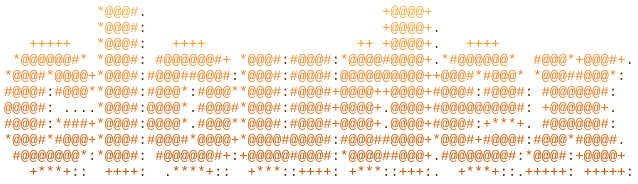

<h1 align="center"></h1>

Open-source agent computers that run in your own Cloudflare account. Each sandbox
is a Linux machine with a shell, Docker, SSH and coding agents. Stopping saves its
disk; resuming brings it back. You pay Cloudflare directly; there is no Cloudex
service in between. Site: [cloudex.build](https://cloudex.build).

**Status: v0.2.1** adds a web dashboard, served by your deployment itself, with
terminals and desktops in the browser. v0.2.0 added OpenCode, keys for six more AI
providers, and access tokens with sign-in by code. v0.1 commands, API routes and
SDK calls still work unchanged.

## What you need

- A Cloudflare account on **Workers Paid** ($5/month). Containers need it.
- An OpenSSH client.
- Optional: a domain in the same Cloudflare account, for preview links. Cloudex adds
  a proxied `*.<domain>` record and routes `*.<domain>/*` to its Worker; requests
  for your other subdomains, like `www`, pass through to their origins.

## Get started

```sh
curl -fsSL https://cloudex.build/install | sh
cloudex deploy --preview-domain example.com     # asks for a Cloudflare API token
cloudex new --name web
cloudex ssh
```

`cloudex deploy` prints a link that opens the Cloudflare dashboard with the token's
permissions pre-filled. It then copies the sandbox image into your account, uploads
the API Worker, and starts a test sandbox. Run it again to update; your sandboxes,
API key and preview domain stay. Leave out `--preview-domain` if you don't want
preview links.

**On another computer**, don't deploy again: that would give the deployment a new
API key and lock out the first computer. Instead run `cloudex login --url <API URL>`
on the new one, which shows a code, and approve it on the first one with
`cloudex tokens approve <code>`. The new computer gets a token of its own.
`cloudex deploy` asks before replacing a key it doesn't have.

**Tokens.** `cloudex tokens create ci --own --expires 90d` makes an API key for CI,
an agent or a teammate: with a role (`admin`, `user` or `read`), limited to the
sandboxes it makes with `--own`, expiring, and revocable at once with
`cloudex tokens revoke`.

**Updating.** `cloudex update` replaces the CLI with the latest release, after
checking it against the release's checksums, then offers to run `cloudex deploy`
if your deployment is older. Sandboxes that are running keep the old version
until they stop. Once a day the CLI checks for a new release and mentions one
after a command; `CLOUDEX_NO_UPDATE_CHECK=1` turns that off.

## Commands

| Command | What it does |
|---|---|
| `cloudex new [--name] [--size standard-2] [--idle 30m]` | Create and start a sandbox; it becomes the current one |
| `cloudex fork [sandbox] [--name] [--count 1-10]` | New sandboxes that start from a copy of one's disk (also `cloudex new --from <sandbox>`) |
| `cloudex save [sandbox] <name>`, `saves`, `saves rm <name>` | Keep a copy of a sandbox's disk under a name, for good; start sandboxes from it with `cloudex new --from <name>` |
| `cloudex env [sandbox]`, `env set NAME=VALUE`, `env unset NAME` | A sandbox's environment variables and files (`--file`, `--env-file`); `cloudex new` takes them too, and `--repo` |
| `cloudex list`, `info`, `use <sandbox>` | See sandboxes and pick the current one |
| `cloudex set [sandbox] [--name] [--idle 2h]` | Rename a sandbox, or change how long it may sit idle |
| `cloudex ssh [sandbox] [-- ssh args]` | Shell in over SSH, through your API (no public IP) |
| `cloudex desktop [sandbox] [--size 1280x720] [--link] [--quality 0-9]` | Open the sandbox's desktop, with Chrome and a terminal, in your browser |
| `cloudex dashboard [sandbox]` | Open the web dashboard, signed in: sandboxes, terminals, desktops, agents, commands, files, saves and access |
| `cloudex exec [sandbox] -- <command>` | Run a command, printing its output as it comes and ending with its exit code; `-d` leaves it running in the background |
| `cloudex commands [sandbox]`, `commands logs -f <id>`, `commands kill <id>`, `commands rm <id>` | List background commands, follow their output, stop them, delete a finished one's record and output |
| `cloudex cp <from> <to>` | Copy files and directories into or out of a sandbox (`web:path`, or `:path` for the current one) |
| `cloudex run [--from <save>] -- <command>` | Run a command in a fresh sandbox with this directory's files, copy back `--out` paths, and delete it; for CI |
| `cloudex ssh-config >> ~/.ssh/config` | Lets `scp`, `rsync` and editors reach `<sandbox>.cloudex` |
| `cloudex prompt [sandbox] "task"` | Start Claude Code, Codex or OpenCode on a task in tmux and watch it |
| `cloudex attach [sandbox]` | Reattach to the newest agent session |
| `cloudex agents start [sandbox] "task"`, `agents`, `logs -f`, `send`, `interrupt` | Run an agent with no terminal and follow it; send follow-ups or steer it |
| `cloudex host [sandbox] <port>`, `--revoke`, `--list`, `--revoke-all` | HTTPS link to a port, on your preview domain (servers on localhost work too); revoke links |
| `cloudex stop`, `resume [--from-backup] [--size]`, `delete` | Save, back up and stop; resume from the save or the backup, on another size if you like; or delete |
| `cloudex login --url <api url>` | Use an existing deployment from another computer, signing in with a code |
| `cloudex tokens create <name>`, `tokens`, `tokens approve <code>`, `tokens revoke <id>` | API keys of their own for CI, agents and other computers, with a role |
| `cloudex keys set <provider>`, `keys`, `keys rm` | Let sandboxes use an AI provider key that never enters them |
| `cloudex doctor`, `status [--show-key]` | Check this computer and the deployment |
| `cloudex update [--check]` | Update the CLI to the latest release, then offer to update the deployment |
| `cloudex feedback "message"`, `--last-error` | Report a bug or an idea as a GitHub issue; keys and addresses are removed, and you see it first |

**Backups.** Each stop also backs up `/home` (without `~/.cache`) and the SSH
host keys to an R2 bucket in your account, `cloudex-backups`, keeping the newest
one per sandbox. A save expires 30 days after it was made or last resumed; after
that, `resume` restores the backup onto a fresh image instead, and anything
installed outside `/home` needs installing again. `cloudex resume --from-backup`
does that on request, and `delete` removes the backups. Backups need R2 turned
on for the account (the free tier is enough); `cloudex deploy` says when it
isn't, and `cloudex status` shows whether they're on.

**Provider keys.** `cloudex keys set anthropic` (or `openai`, `openrouter`,
`google`, `groq`, `mistral`, `xai`, `deepseek`) stores an API key in your
deployment, encrypted. Sandboxes started after that get a placeholder
key, and the real one is added to their HTTPS calls to the provider as they
leave, so it never enters a sandbox, its saves, backups or forks. Claude Code,
Codex, OpenCode, the providers' SDKs and curl work as if the key were there,
with no sign-in. `cloudex keys set` tries the key with the provider first and refuses one
it rejects. A key a sandbox brings itself is used as is. While the deployment
holds a provider's key, the agents in a sandbox use it even if someone
signs in there with a subscription; to use a subscription instead, remove the
key with `cloudex keys rm`. A new provider reaches a running sandbox when it next
starts; a changed or removed key reaches it within a minute. `cloudex info`
shows which providers a sandbox uses this way. The keys are encrypted with the
admin key, so after `cloudex deploy --yes` replaces it, set them again.

**Settings.** `cloudex new --env NAME=VALUE --env-file .env --file .npmrc=./npmrc
--repo https://github.com/you/app` gives a sandbox environment variables that
every shell, ssh session, exec and agent gets, files in its home directory, and
a repo cloned when it's created. Variables and files apply at every start, and
`cloudex env set` changes them on a running sandbox at once; forks get a copy.
The deployment keeps them encrypted and only shows names and paths. With
`GH_TOKEN` or `GITHUB_TOKEN` set, git clones and pushes private GitHub repos and
`gh` works.

**Forks.** `cloudex fork` makes new sandboxes that start from a copy of a
sandbox's whole disk, including installed packages and agent logins. A running
sandbox is saved first, which takes seconds and leaves it running; a stopped one
is copied from its last save. `--count 10 --name agent` makes `agent-1` to
`agent-10` at once (ten forks took about 20 seconds in testing). Each fork is a
separate sandbox with its own id, saves and backups, and `cloudex info` shows
what it was forked from. A sandbox whose save has expired needs a `resume`
before it can be forked.

**Named saves.** A sandbox's own save goes 30 days after it was last made or
resumed from. `cloudex save my-box base` keeps a copy of a running sandbox's
disk in your R2 bucket under a name until you delete it, and `cloudex new
--from base` (with `--count` and `--name`, like a fork) starts new sandboxes
from it. Set up a sandbox once (packages, Docker images, repos, agent logins,
`~/.cloudex/start`) and start as many as you like from it later. The image
lists its own files, so a save holds only what the sandbox changed, plus its
settings; SSH host keys are left out, so each new sandbox makes its own. Saving
and restoring each take about 15 seconds per GB. A save restores in full onto
the image it was made on; after a `cloudex deploy` that brings a new image,
only `/home` comes back, and the new sandbox's notice says so. Saving under a
taken name replaces that save. `cloudex saves` lists them, and `saves rm`
deletes one. Named saves need R2, like backups.

**Commands, files and CI.** `cloudex exec` streams a command's output as it's
printed, and `exec -d` leaves a long job or a server running in the background,
with its output kept on the sandbox's disk for `cloudex commands logs -f`.
`cloudex cp` copies files and directories in and out; copying a directory out
leaves out `.git` directories, hard links, and links that point outside it.
`exec` doesn't send standard input to the command, and its output is text: put
a file in a sandbox with `cloudex cp`, and copy a binary file out with
`cloudex cp web:file ./file`. `cloudex run -- npm test` starts a sandbox (or
one from a named save, with `--from`), copies in the files git would commit,
runs the command, copies back what `--out` names, deletes the sandbox and exits
with the command's code, so a CI step can run its tests in your Cloudflare
account.

**Desktop.** `cloudex desktop` starts a desktop in the sandbox (TigerVNC,
openbox, Chrome and a terminal) and opens it in your browser through noVNC. The
first time installs it, which takes a minute or two; a save keeps it, so later
starts take seconds. The CLI forwards a local port until you press Ctrl-C, and
the desktop keeps running in the sandbox after that. `--link` prints an HTTPS
link on your preview domain instead, for any browser and anyone you give it to.
Windows opened from the sandbox's shells, such as an agent's browser, show up
on it; the desktop's Chrome also listens for automation on `localhost:9222`
inside the sandbox. A connected viewer counts as activity for idle stop.
On a slow connection, `--quality 0` (of 0 to 9; 3 by default) cuts the
bandwidth of moving pictures by more than half; text stays sharp. `--stop`
ends the desktop and its programs.

**Inside a sandbox**, `cloudex` manages that sandbox and nothing else, with no
key: `cloudex host 3000` prints a preview link, and `info`, `set --idle` and
`stop` work too. Claude Code, Codex and OpenCode in the sandbox are told about it, so an
agent that starts a server can hand you its link. Commands in
`~/.cloudex/start` run at every start, to bring servers back after a resume.
For coding agents on your own computer, [skills/cloudex](skills/cloudex/SKILL.md)
is a skill that teaches them the CLI.

Sandboxes stop and save after `--idle` without SSH, exec, preview or agent
activity (30 minutes by default), and in any case within Cloudflare's 6-hour
limit. An open `cloudex ssh` session counts, since it sends a keepalive every
30 seconds; a connection that has gone silent doesn't. With provider keys, an
agent's calls to its provider count too. Without them, agents need signing in
once inside the sandbox (`cloudex ssh`, then run `claude`, `codex` or `opencode`); the login
is saved with the disk, and copied into forks.

## SDKs

The [TypeScript SDK](packages/sdk) and the [Python SDK](python) do what the CLI
does from code: create, fork, exec, host links, desktop, stop and resume, and
named saves (`box.save`, `cx.startFromSave`). They also drive agents, like
`cloudex agents`: start Claude Code, Codex or OpenCode on a task with no terminal, follow
its events, send it follow-ups, and interrupt or steer it. The agent and its
conversation live on the sandbox's disk, so a fork can take the same
conversation somewhere else. The SDKs use the deployment the CLI saved, or an
API URL and key you pass in. The saved key is used only with the saved URL; for
any other URL, pass the key too. They are for servers and scripts: the API sends
no CORS headers, so a browser page can't call it.

```sh
npm install cloudex
pip install cloudex
```

The API describes itself at `<your API URL>/v1/openapi.json`.

```ts
const box = await new Cloudex().create({ name: "web" });
const forks = await box.fork({ count: 10 });
await Promise.all(forks.map((f) => f.exec("npm test")));

const agent = await box.prompt("make the tests pass"); // Claude Code; { agent: "codex" } or "opencode"
for await (const event of agent.events()) console.log(event.type, event.event ?? event.text ?? "");
console.log(agent.lastMessage);
await (await agent.send("now update the docs")).wait();
```

## Feedback

`cloudex feedback "what happened"` (or `--last-error` after a command fails)
files a report here, as a public issue, after removing keys, addresses and the
sandbox names it knows of, and showing it to you. Agents get the report and a
`--send <id>` command to run once you agree. Report security problems privately: see
[SECURITY.md](SECURITY.md). Maintainers triage reports with the
[triage-feedback](.agents/skills/triage-feedback/SKILL.md) skill.

## Layout

| Path | What |
|---|---|
| `apps/api` | Control plane Worker: the `/v1` API, the dashboard at `/`, and one `Sandbox` Durable Object per sandbox, each owning one container |
| `apps/dashboard` | The web dashboard (Preact, xterm.js and noVNC), built into the API Worker |
| `images/base` | The sandbox image: Ubuntu 24.04, Node, Python, Docker, sshd, tmux, Claude Code, Codex and OpenCode |
| `go/cmd/cloudex` | The `cloudex` CLI |
| `packages/schema` | Zod models shared by the API and the SDKs, and the OpenAPI document built from them |
| `packages/sdk` | The TypeScript SDK, [`cloudex` on npm](https://www.npmjs.com/package/cloudex) |
| `python` | The Python SDK, [`cloudex` on PyPI](https://pypi.org/project/cloudex/) |
| `skills/cloudex` | A skill that teaches coding agents on your computer to use the CLI |
| `scripts/` | `bundle-api.sh` embeds the API in the CLI; `build-cli.sh` builds release archives |

## Develop

```sh
pnpm install && pnpm typecheck && pnpm test
cd go && go test ./...
cd python && PYTHONPATH=src python3 -m unittest discover -s tests

# API and dashboard on localhost:8787 without the container image
echo 'ADMIN_KEY=dev-admin-key' > apps/api/.dev.vars
pnpm --filter @cloudex/dashboard build
pnpm --filter @cloudex/api exec wrangler dev --enable-containers=false

# CLI with the current API bundle (and the dashboard in it) embedded
scripts/bundle-api.sh && (cd go && go build -o bin/cloudex ./cmd/cloudex)
```

To try changes to the image or API in your account, `cd apps/api && npx wrangler
deploy` builds the image from `images/base` (Docker needed), then set the
`ADMIN_KEY` secret and point the CLI at it with `CLOUDEX_API_URL` and
`CLOUDEX_API_KEY`. A newly pushed image can take up to 20 minutes before a
sandbox can start on it.

Before a release, run the verify-release skill
(`.agents/skills/verify-release/SKILL.md`) against a test deployment.

Releases: push a `v*` tag. CI publishes `ghcr.io/lucataco/cloudex-base:<tag>` and
CLI archives built against it.

## License

[MIT](LICENSE)
